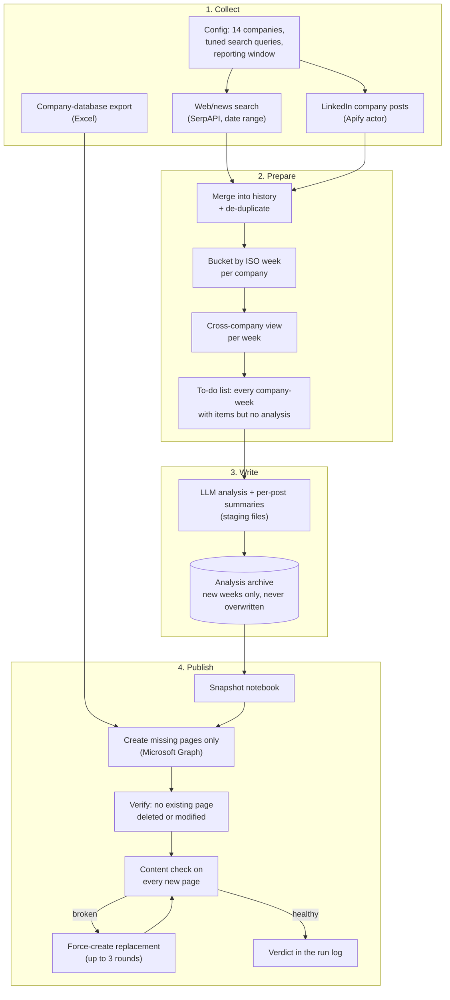

# Competitor Monitoring Pipeline

A weekly **competitor-intelligence digest** for 14 cybersecurity service providers competing in the Southeast
Asian market. Every week the pipeline:

1. collects each competitor's LinkedIn posts and web/news mentions;
2. groups them by company and ISO week;
3. has an LLM write a short analysis for each active company-week, plus one cross-competitor digest per week;
4. publishes the result as OneNote pages through the Microsoft Graph API, **append-only**, so pages that readers
   have edited by hand are never touched.

It was backfilled from the first week of 2026 and then ran unattended every Monday. By week 43 the notebook held
**about 480 pages in 15 sections**.

**Built with:** Python 3 (standard library for every API call, openpyxl for Excel), Microsoft Graph API (OneNote),
SerpAPI (Google search with date ranges), an Apify actor for LinkedIn company posts, Claude Code run headless as the
analysis writer, Windows Task Scheduler.

---

## At a glance

| Measure | Value |
|---|---|
| Competitors tracked | 14 |
| Reporting window | ISO weeks 2026-W01 to 2026-W43 (29 Dec 2025 to 25 Oct 2026) |
| Source items in the window | 1,104 LinkedIn posts and 293 dated web/news results |
| Company-weeks with activity | 426 of 602. Empty weeks are skipped, so there are no blank pages |
| Pages | 14 profile pages + 426 company-week pages + 43 weekly digests, in 15 sections |
| Per-post summaries | 1,093 (2-4 sentences each, written by the LLM) |
| Cadence | Weekly, Monday 10:00, unattended |
| Scraping cost per weekly run | about US$2 (web search stays inside a free tier) |

## How it works



Each stage is a small script that can be run on its own, and every stage is **safe to re-run**: the scrapers merge
instead of overwriting, bucketing is rebuilt from scratch, and publishing only creates what is missing.

## 1. Collection

- **One config file** lists the 14 companies (ID, name, home country, LinkedIn page, website, search query) and the
  run settings: backfill start (Monday 29 Dec 2025, which is ISO week 2026-W01), window end, posts per company.
- **Web and news:** a Google search through SerpAPI with a custom date range, sorted by date, about one search per
  company per run. A weekly run searches **back 13 days** so items that search engines index late are still caught.
- **LinkedIn:** an Apify actor returns the newest N posts of a company page. It has no date filter, so N is kept at
  30-50 (about US$5 per 1,000 posts).
- **Company profiles:** a company-database export in Excel feeds a profile page per company. The export is
  *ragged*: list fields (founders, investors) shift column depending on how many items the earlier fields had. The
  converter classifies each value by the type of link next to it (person link or organisation link) instead of
  trusting column positions.
- **Both scrapers merge into the history on disk.** The first version overwrote its output files, which would have
  cut off everything older than the newest N posts.

## 2. De-duplication and identity

- **Web results** are de-duplicated by link.
- **LinkedIn posts are keyed by the activity URN, not the post URL.** The scraper adds tracking parameters to the
  URL on every run, so the same post came back with a different URL each time. A repost also carries the
  *original* post's URL, so URL-based de-duplication silently merged three real posts into others. They were
  recovered from a backup.
- When a post appears twice, the **freshest copy wins** because it has the newer reaction and comment counts.
- A free `--dedupe-only` pass re-applies the rule to files already on disk without calling any API.
- **Per-post summaries use the same URN key.** The lookup also accepts the URL with and without its query string,
  so a summary written under the old key is never orphaned. Posts without a summary fall back to a short excerpt,
  and the matched / fallback counts are printed on every run.

```python
def post_key(post: dict) -> str:
    # URLs change between scrapes (tracking parameters) and reposts reuse the
    # original URL, so the activity URN is the only stable identity.
    urn = post.get("activity_urn") or post.get("full_urn")
    return urn or (post.get("post_url") or "").split("?")[0]
```

## 3. Weekly buckets

- **A defensive date parser** accepts ISO dates, "Jan 7, 2026", "7 Jan 2026" and epoch seconds or milliseconds.
- **Items with no parseable date are held aside in an `undated` bucket, not guessed.** Most web results carry no
  date (741 of 1,034 on file), so only dated items reach the weekly pages.
- **The window ends on the Sunday of the last completed ISO week**, so a half-finished week is never published.
  Items outside the window are counted and reported, not silently dropped.
- Each company gets one bucket per week. A cross-company view per week feeds the weekly digest.

## 4. LLM analysis with guard rails

- **The to-do list is computed, not assumed.** It lists *every* company-week that has source items but no
  analysis, not just the latest week. When items for an earlier week arrive late, that week is picked up
  automatically (the week-43 run also wrote four pages for week 42).
- **A compact reader** prints only what the writer needs (date, engagement, text and URN per item), so it never
  has to open multi-megabyte JSON files.
- **Writers fan out in parallel:** one per company, plus a few for the digest weeks.

Every writer fills a fixed schema (simplified here):

```json
{ "weeks": { "2026-W37": {
    "headline": "one line",
    "analysts_take": "4-6 paragraphs",
    "observed_themes": ["...", "..."],
    "strategic_profile": {
      "marketing_messages": "...", "social_impact_trends": "...",
      "message_subtext": "...", "brand_narrative": "..." } } } }
```

The weekly digest adds a **sight key** (the main lens the market used that week) and a cross-competitor synthesis.
Each LinkedIn post gets a 2-4 sentence summary keyed by its URN.

**Writing rules:**
- One consistent analyst voice.
- Cite specifics from the source: engagement counts, product names, dates, regulations.
- Say plainly when a week is thin instead of inflating it.
- **Never invent facts, numbers or quotes** that are not in the source material.
- End with concrete, actionable recommendations.

**The archive is immutable.** New text goes to staging files. A merge step adds only weeks that are not in the
archive yet, and it refuses to overwrite an existing week unless `--force` is passed. The staging folders are
cleared at the start of every run, so last week's drafts can never be merged twice.

## 5. Publishing to OneNote, append-only

**Notebook layout:** one section per competitor (a profile page, then one page per active week) and an
"Overall - Weekly" section with the digests.

**Each company-week page contains:**
- the headline;
- the analyst's take, as a coloured callout;
- the observed themes;
- the strategic-profile table;
- the web/news items and LinkedIn posts with their summaries. Posts are sorted by reactions.

OneNote drops most CSS borders, so callouts are built from table cells with background colours. The XHTML uses
numeric entities. Sign-in uses the device-code flow, and the access token refreshes during long runs.

**Why append-only:** readers annotate the pages by hand in OneNote, and those edits exist nowhere else. So:

- The publisher only **creates** pages. It has no update call at all.
- Every destructive command ("wipe", "replace", delete a page) **refuses to run** without an explicit
  `--yes-delete-my-edits` flag. The delete function itself is blocked unless that flag has been passed.
- **Idempotency keys on the ISO week label found anywhere in the title.** A page that a reader renamed still counts
  as present, so it is never duplicated.
- **Every publish runs in the same order: snapshot → dry run → push → verify.** The verify step compares page IDs
  and last-modified times per section against the snapshot. Any deleted or modified pre-existing page is a FAIL.

```python
WEEK = re.compile(r"\d{4}-W\d{2}")

def published_weeks(titles):
    # Match the week label anywhere in the title: a page a reader renamed
    # still counts as present and is never duplicated or overwritten.
    return {m.group(0) for t in titles if (m := WEEK.search(t or ""))}

done = published_weeks(page_titles(section))
for week in active_weeks(company):
    if week not in done:
        create_page(section, page_title(company, week), render(company, week))  # POST only
```

## 6. Self-healing: OneNote failure modes and how each is handled

| Symptom | Cause | Handling |
|---|---|---|
| HTTP 429 / 5xx | API throttling | Retries honour `Retry-After`, otherwise exponential backoff capped at 90 s, up to 9 tries. Before publishing, one cheap request per minute checks whether the throttle has cleared (up to 3 h). Pages are created 2.5-8 s apart. |
| A page is created **without its title** | Throttling. Plain short titles failed too, so it was not the title text. On one catch-up run it hit **16 of 91 pages (~18%)** at 2.5 s pacing | Snapshot after the push. Delete **only** untitled pages that are absent from the "before" snapshot, so a hand-edited page can never be removed. Re-push at a slower pace (6 s, then 12 s). |
| Page listed but its **content is missing** on the server; delete returns 404 | Throttled create | **Content check:** fetch the page body. HTTP 200 and at least 600 bytes = healthy, 404 = broken. Any other status is recorded as "unverified" and re-checked; it is never treated as broken. A broken page gets a **fresh replacement created beside it** (up to 3 rounds), and the blank leftover is listed for a person to delete. |
| Listing sections fails with **403, code 10008** | The storage library holding the notebook passed 5,000 items, so Graph refuses list queries | A cached map of section IDs, rebuilt from one page per section in a snapshot (page → parent section). Calls made directly by ID still work, so duplicate protection and snapshot/verify keep working. |
| Older pages showed `News &amp; Web` as visible text | Generator bug: one heading was HTML-escaped twice | Generator fixed. A repair script patched only the single affected element on each page, found by element ID, so hand edits elsewhere on the page stayed intact. Dry run first, progress saved so it could resume; 176 published pages were affected at the time. |
| New weeks land at the bottom of a section | Graph cannot reorder pages | An export tool saves the live HTML of every page, hand edits included. A rebuild tool can recreate a section in order from that export, and it aborts if any live page is missing from the export. In normal runs, ordering is left to a person in the OneNote app. |

The verify step is deliberately conservative. On one run it flagged 16 older pages as "modified" with timestamps
from months earlier, most likely a timestamp mismatch rather than an edit. The run logged it for a person to
spot-check instead of "fixing" anything.

## 7. Scheduling and runbook

- **Three stages:** prepare (scripts) → write (LLM) → publish (scripts). The weekly job is a Windows Task
  Scheduler task (Monday 10:00, wake the computer, run as soon as possible after a missed start). A wrapper runs
  Claude Code headless with one instruction: follow the runbook top to bottom, then stop. All output goes to a dated
  log.
- **Hard rules in the runbook:**
  - Never wipe or replace.
  - Never delete a page the current run did not create.
  - One LinkedIn scrape per run (budget about US$2).
  - Run the publish step in the foreground.
  - If a step fails twice, log it and stop. Do not improvise repairs.
- **"Nothing to do" is a normal result.** If the week is already published, the to-do list is empty and the run
  stops.
- **Every run ends with one verdict line,** for example *"ALL 29 expected page(s) verified healthy"*, or a list of
  the pages that still need a person.

**Bugs found by running unattended, and their fixes:**
- The Windows console's default encoding crashed a run mid-publish on characters in the scraped text. Output is now
  forced to UTF-8.
- The log-file name took only the year from the date, so every run appended to one file. It now uses the full date.
- A hard-coded end date in the search script silently returned nothing after that date. The date now comes from the
  config.
- The scheduled task's path quoting silently ran nothing. The path is now in single quotes.
- The to-do list was computed from a stale cross-company file, so new weekly digests were never flagged. That file
  is now refreshed first.

## 8. Data-quality checks

- **Tight search queries.** Loose company-name queries returned a scripture verse, a hiking trail, a caterer and an
  unrelated securities firm. The queries were tightened and the false positives removed.
- **Roster check.** A tracked company that has posted no content of its own all year, and whose search results
  are only noise from unrelated namesakes, is flagged for review instead of producing empty pages.
- **Counts on every stage:** items returned / new / total per scrape, active weeks and out-of-window items per
  company, summaries matched vs fallback, pages before / after / added per publish.
- **"Confirm before quoting" list:** claims about a competitor's ownership or licences were flagged for a person to
  check before anyone repeated them.

## Outcome

- **Full backfill of weeks 1-26 in one pass (June 2026), catch-up runs for weeks 27-36, then unattended weekly runs
  from late September to late October 2026.** The weekly job was switched off after week 43.
- About 480 pages across 15 sections.
- Each unattended run checked 12-29 expected pages. A few pages per run needed an automatic replacement. In
  each of the last two runs, one page still needed fixing by hand, and the run log said so.
- This replaced an earlier no-code workflow in which a single LLM call wrote one combined report per week. The
  rebuild gives one page per company per week, adds web/news as a second source, and keeps a permanent JSON
  archive.

## What I'd improve

- **Alert when a source returns zero results.** The web-search source returned nothing for the final four weeks, and
  that was only noticed weeks later.
- **Automated checks on the LLM text,** not just rules in the prompt: validate the schema, and check that every
  number and quote in an analysis appears in that week's source items.
- **Host the notebook on a shared team site under a service account** instead of a personal account, which also
  avoids the 5,000-item storage limit.
- **Store items and engagement in a small database** (e.g. SQLite) so posting volume, engagement and themes per
  competitor can feed a trend dashboard.

---

*No collected posts, analysis text or competitor names are included in this repository. The source code is not
included.*
