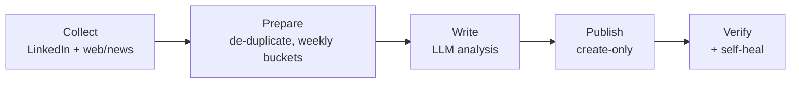

# Competitive Intelligence Digest Pipeline

A weekly **competitor-intelligence digest** for 14 cybersecurity service providers in the Southeast Asian market.
The pipeline collects each competitor's LinkedIn posts and web / news mentions, groups them by company and ISO week,
has an LLM write a short analysis, and publishes OneNote pages through the Microsoft Graph API, **append-only**, so
pages that readers edited by hand are never touched. By week 43 of 2026 the notebook held **about 480 pages**.

## At a glance
- **Sources:** 1,104 LinkedIn posts and 293 dated web / news results (ISO weeks 2026-W01 to W43).
- **Pages:** 14 company profiles, 426 company-week pages and 43 weekly digests, in 15 sections.
- **Cadence:** every Monday at 10:00, unattended, for about US$2 of scraping per run.

## How it works
- **Collect:** web / news search with a date range and an actor for LinkedIn posts. Both merge into the history on
  disk instead of overwriting it.
- **De-duplicate:** LinkedIn posts are keyed by their activity URN, not the URL (URLs change between scrapes, and
  reposts reuse the original URL). Items with no readable date go to an `undated` bucket instead of being guessed.
- **Write:** a computed to-do list of every company-week that has items but no analysis. LLM writers fill a fixed
  JSON schema and must never invent facts. The archive only gains new weeks; it is never overwritten.
- **Publish:** create-only (no update call), keyed on the ISO week label in the page title. Every run goes snapshot,
  dry run, push, verify; a deleted or modified existing page is a FAIL.
- **Self-heal:** retries with backoff for throttling, a content check on every new page, and a replacement page for
  any broken one (up to 3 rounds). Every run ends with one verdict line.

*No collected posts, analysis text, competitor names or source code are included in this repository.*

**Tools:** Python 3, Microsoft Graph API (OneNote), SerpAPI, Apify, Claude Code (headless) as the analysis writer,
Windows Task Scheduler · built with Claude Code as a coding assistant
